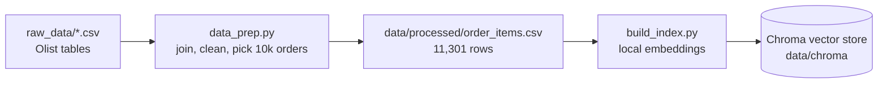
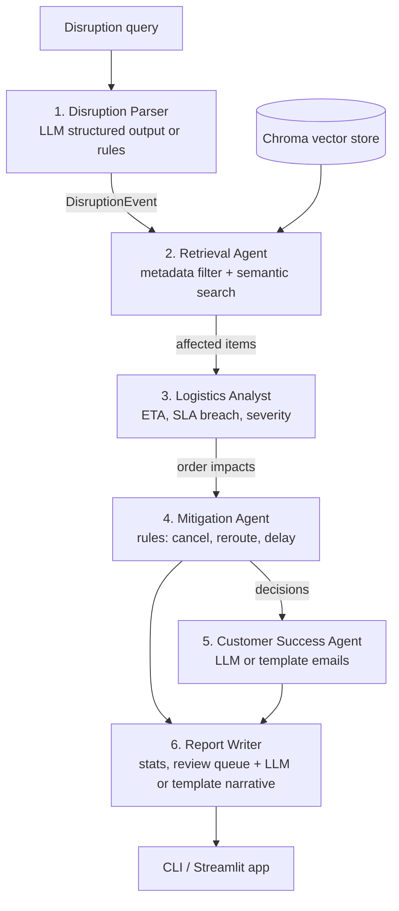

# Architecture: Supply Chain Disruption Response System

An AI-assisted decision system that takes a disruption described in plain English, finds the affected
orders in the Olist dataset, decides what to do with each one, and drafts customer emails.

> Example input: *"Heavy rains are delaying all freight leaving Sao Paulo for the next 5 days"*
>
> Output: an impact summary (orders, sellers, SKUs, severity, actions, cost) and sample customer emails.

---

## 1. Design principles

These six rules drive every decision in this document.

1. **LLM for language, code for numbers.** The LLM reads the disruption text and writes emails and summaries.
   Dates, severity and actions are computed by plain Python so they are correct, repeatable and testable.
2. **Filters for facts, embeddings for meaning.** "Which orders ship from SP?" is an exact question, so it
   uses a metadata filter. "Which of those are heavy furniture?" is a fuzzy question, so it uses semantic search.
3. **A fixed pipeline of specialized agents.** Each agent does one job and passes a typed result to the next.
   The order of steps is fixed, which makes the system predictable and easy to debug.
4. **Every decision is explainable.** Each order carries a list of plain-English reasons, and every run
   records a step-by-step trace.
5. **Simple over clever.** Plain Python functions, Pydantic models and one vector store. No agent framework.
6. **Runs without an LLM.** Every LLM step has a deterministic counterpart: a rule-based parser and
   template emails and summaries. The whole system runs and is tested with no key. The LLM improves
   the wording, never the numbers.

---

## 2. System overview

### 2.1 Offline: build the knowledge base (run once)



### 2.2 Online: respond to a disruption



`pipeline.py` is the orchestrator. It calls the six steps in order, passes each output to the next step,
records a trace, and stops early when there is nothing left to do (for example, no location found or no
affected orders).

### 2.3 Run modes

| Mode | When | Parser | Emails and summary |
|---|---|---|---|
| Gemini | `GEMINI_API_KEY` is set | Gemini structured output | Gemini |
| Offline | No key, `LLM_MODE=offline`, `--offline` or the app toggle | Rule-based parser | Templates |

Retrieval, severity, decisions and every number are the same in both modes. In Gemini mode, a busy model
(503) is retried with backoff, and a rate-limited model (429) is replaced at once by the next model in
`GEMINI_FALLBACK_MODELS`, because free-tier quotas are per model. Only when every model fails does the
step fall back to its offline counterpart. Later steps in that run then skip Gemini, and the report says so.

---

## 3. Data layer

### 3.1 Source tables

| Table | Used for | Key columns |
|---|---|---|
| Orders | Status, purchase date, promised date, actual delivery date | `order_id`, `customer_id`, `order_estimated_delivery_date` |
| Order Items | The SKU-level grain, price, freight cost | `order_id`, `order_item_id`, `product_id`, `seller_id` |
| Products | Category, weight, dimensions | `product_weight_g`, `product_*_cm` |
| Sellers | Where freight leaves from | `seller_city`, `seller_state` |
| Customers | Where freight goes to, email personalization | `customer_city`, `customer_state` |
| Category translation | English category names | `product_category_name_english` |

The case study names the first four tables. Customers and the category translation table are added because
"inbound" disruptions and personalized emails need the destination city, and English categories make the
emails and semantic search better. Geolocation, payments and reviews are not used.

### 3.2 Validation results

All tables were checked before designing the system.

| Check | Result |
|---|---|
| Row counts | 99,441 orders, 112,650 items, 32,951 products, 3,095 sellers |
| Duplicate primary keys | None |
| Broken joins (item to order, product, seller; order to customer) | None |
| Orders without items | 775, dropped by the join |
| Products without category | 610, labelled `unknown` |
| Products without weight or size | 2, labelled not bulky |
| Categories without English name | 2, fall back to the Portuguese name |
| Translation file | Has a UTF-8 BOM, so it is read with `utf-8-sig` |
| Order status | 97% delivered. Real "in-flight" orders are too few, so the system simulates them (see assumptions) |

### 3.3 The working subset

- **Rule:** the 10,000 most recent orders that have items and are not `canceled` or `unavailable`.
- **Size:** 10,000 orders, 11,301 items, purchased 2018-07-17 to 2018-09-03.
- **Grain:** one row per order item. An order can hold items from different sellers in different states,
  so only the items shipped from the disrupted region are affected. Results roll up to the order for emails.

### 3.4 Derived fields (computed in `data_prep.py`)

| Field | Formula |
|---|---|
| `weight_kg` | `product_weight_g / 1000` |
| `volume_l` | `length × height × width / 1000` |
| `is_bulky` | `weight_kg >= 10` or `volume_l >= 60` (about the top 5% of items) |
| `is_time_sensitive` | Category in a short list: flowers, food, food_drink, drinks, party_supplies, christmas_supplies |
| `promised_date` | `order_estimated_delivery_date`, the date the customer was promised |
| `baseline_eta` | Actual delivery date if known, else the promised date. This is "what would happen with no disruption" |

### 3.5 Vector store

- **Store:** Chroma in local persistent mode, one collection called `order_items`.
- **Embedding model:** `all-MiniLM-L6-v2`, Chroma's built-in model. It runs locally on the CPU, needs no API
  key and costs nothing. Retrieval therefore works in offline mode too.
- **One document per order item.** The text is written for semantic search, and the metadata is used for filters:

```text
Document:  Office furniture (moveis_escritorio). Heavy, bulky item: 15.5 kg, 47 L.
           Ships from a seller in itaquaquecetuba, SP to a customer in bauru, SP.
           Price R$ 136.99, freight R$ 66.04. Promised delivery 2018-08-20.

Metadata:  order_id, product_id, seller_id, seller_city, seller_state, customer_city,
           customer_state, category, weight_kg, volume_l, is_bulky, is_time_sensitive,
           price, freight_value, promised_date, baseline_eta
```

---

## 4. The agents

Every agent is one Python file with one `run(...)` function, a typed input and a typed output.

| # | Agent | Uses LLM? | Responsibility |
|---|---|---|---|
| 1 | Disruption Parser | Yes | Turn free text into a structured `DisruptionEvent` |
| 2 | Retrieval Agent | Embeddings only | Find all affected items, and rank them by product relevance |
| 3 | Logistics Analyst | No | Compute new ETA, days late and severity for each item and order |
| 4 | Mitigation Agent | No | Pick cancel, reroute, delay or monitor for each order, with a reason |
| 5 | Customer Success Agent | Yes | Write a personalized, empathetic email for an order |
| 6 | Report Writer | Yes, one call for the narrative | Build impact statistics, flag orders for human review, and write the summary, next steps and review notes |

### 4.1 Disruption Parser (LLM)

**Input:** the query text. **Output:** `DisruptionEvent`.

```python
class DisruptionEvent(BaseModel):
    disruption_type: Literal["weather", "strike", "infrastructure", "port_closure", "other"]
    states: List[str]            # Brazilian state codes, e.g. ["SP"]
    cities: List[str]            # e.g. ["curitiba"], empty means the whole state
    direction: Literal["outbound", "inbound", "both"]   # leaving, arriving, or both
    delay_days: int              # 1 to 30
    product_focus: str           # e.g. "heavy bulky items such as furniture and home goods"
    interpretation: str          # one sentence: how the system understood the query
```

- Uses Gemini structured output (`responseJsonSchema` built from the Pydantic model), and Pydantic
  validates the reply.
- Code then checks the result: state codes must be one of the 27 Brazilian states, city names are lowercased
  and accents are removed to match Olist spelling ("São Paulo" becomes "sao paulo").
- **Defaults:** if no duration is given, 3 days. If no direction is given, outbound. If no product focus is
  given, "heavy bulky items such as furniture and home goods".
- **Ambiguous names:** "Sao Paulo" and "Rio de Janeiro" are both a city and a state. The system treats them as
  the state unless the text says "city". Over-notifying is safer than missing customers. The `interpretation`
  sentence shows the user what was assumed, so they can rephrase.
- **Rule-based parser:** used in offline mode and whenever Gemini fails. It matches:
  - state names and uppercase codes
  - city names taken from the dataset, after the state names are removed
  - direction keywords ("leaving", "into", "both ways")
  - durations ("5 days", "a week", "48 hours")
  - disruption keywords.

  It lives in `rule_parser.py`.
- **Shared validation for both paths:** the code checks state codes and normalizes cities. When cities are
  given, it drops the states, because retrieval filters on the cities. It then lists every default applied,
  checked against the query text so a note only appears when a default was really used. Finally it writes
  the `interpretation` sentence from the validated fields, so the sentence always describes exactly what
  retrieval will search, whichever path parsed the query. Both paths give identical events for the plan's
  test queries.
- **Stop condition:** if no location is found, the pipeline stops with a clear message.

### 4.2 Retrieval Agent (hybrid search)

**Input:** `DisruptionEvent`. **Output:** the list of affected items, plus the items that best match the product focus.

It runs two searches against the same Chroma collection.

| Step | Search type | Chroma call | Why |
|---|---|---|---|
| A | Metadata filter | `collection.get(where=...)` | Returns **every** item in the region. Counts must be complete, and top-k search cannot guarantee that. |
| B | Semantic search inside the filter | `collection.query(query_texts=[product_focus], where=..., n_results=50)` | Ranks affected items by meaning, e.g. "heavy furniture" also finds `office_furniture`, `housewares` and `bed_bath_table` without a hand-written category list. |

- The filter field depends on direction: `seller_*` for outbound, `customer_*` for inbound, `$or` of both for both.
- If cities are given, they are used instead of states. Example filter: `{"seller_state": {"$in": ["SP"]}}`.
- Items found in step B get `focus_match = True`. This flag is used to rank orders and to list "priority SKUs"
  in the report. It does not change severity, because severity must stay rule-based.

### 4.3 Logistics Analyst (deterministic)

**Input:** affected items and `delay_days`. **Output:** one `OrderImpact` per affected order.

Computes the impact **if we do nothing**:

```text
buffer_days = promised_date - baseline_eta
new_eta     = baseline_eta + delay_days
days_late   = max(0, new_eta - promised_date)
```

Severity per item:

| Days late | Severity |
|---|---|
| 0 (the buffer absorbs the delay) | LOW |
| 1 to 2 | MEDIUM |
| 3 to 6 | HIGH |
| 7 or more | CRITICAL |

- **Weight rule:** a bulky item that is late moves up one level, capped at CRITICAL. Heavy freight needs
  special carriers and its backlog clears more slowly.
- **Negative buffer:** about 5% of items were delivered late in real life, so their buffer is negative.
  The formula stays the same, and the reasons say "already N days late before the disruption".
- **Order severity** is the worst severity of its affected items.
- Each order gets reasons, for example: *"Buffer 2 days, delay 5 days, so 3 days late: HIGH. Bulky (18.2 kg): raised to CRITICAL."*

### 4.4 Mitigation Agent (deterministic rule table)

**Input:** `OrderImpact` list. **Output:** a `Decision` for each order: action, resolution offer, final ETA, rule ID and reason.

Rules are checked top to bottom, and the first match wins.

| Rule | Condition | Action | Customer resolution | Final ETA |
|---|---|---|---|---|
| R0 | Severity LOW | MONITOR | None, no email | Unchanged |
| R1 | Has a time-sensitive item and severity HIGH or CRITICAL | CANCEL | Free cancellation with full refund | None |
| R2 | Has a bulky item | DELAY | Freight charge refunded | `new_eta` |
| R3 | Severity HIGH or CRITICAL | REROUTE | Free expedited shipping via an unaffected route | `baseline_eta + 2 days` |
| R4 | Anything else (MEDIUM) | DELAY | 10% voucher for the next order | `new_eta` |

Why these rules:

- **Time-sensitive goods** lose their value when late (party supplies, food, flowers), so a refund is better than a late delivery.
- **Bulky goods** are expensive and slow to reroute, so waiting is cheaper. Refunding the freight is a fair gesture.
- **Small goods** are cheap to move by another carrier, so rerouting recovers most of the delay.
- **Rerouting through another seller** was considered. Only 3.7% of products have a second seller, so it is not a general option.

All thresholds, the reroute penalty and the voucher size live in `config.py`. The rule table itself is
`RULES` in `mitigation_agent.py`, and the report shows it as the **mitigation plan**: per rule, the number
of orders, the average days late without and with the action, and the cost. In the Sao Paulo scenario,
rerouting cuts the average delay of its 1,389 orders from 5.5 days to 2.5.

### 4.5 Customer Success Agent (LLM)

**Input:** one order with its decision. **Output:** `EmailDraft(subject, body)`.

- The prompt receives only verified facts: order reference, customer city, item categories, promised date,
  final ETA, action and resolution.
- Instructions: be empathetic and concise, explain the cause plainly, state the new date and the resolution,
  give one clear next step, and never invent facts, dates or offers.
- **Post-check in code:** the email must contain the final ETA (or the word "refund" for cancellations). If the
  check fails, the email is regenerated once. If it fails again, the template email is used.
- **Templates:** there is one hand-written template per resolution, filled with the same facts. In
  offline mode they are the only emails, so they are written to read as finished emails, not as placeholders.
- **Name:** Olist has no customer names, so emails open with "Hello" and mention the customer's city.
- **Which emails are generated:** the report shows sample emails, by default one for the most severe order
  of each action type (cancel, reroute, delay). Orders that were on time before the disruption come
  first, because an order that was already weeks late in the real data is not a fair example. In production, every non-MONITOR order would get an email
  through a queue.

### 4.6 Report Writer

- Computes the statistics in code: affected orders, items, sellers and customers, value at risk,
  percentage late, counts by severity and action, top categories, top sellers, priority SKUs and
  estimated compensation cost.
- **Review queue (code, `review_queue.py`).** Unusual orders are flagged for a person to check before their
  emails go out. The flags are: already 3 or more days late before the disruption, still 3 or more days
  late after a reroute, worth R$ 500 or more, items from more than one seller, and both bulky and
  time-sensitive. A flag never changes an action. The report shows how many orders were flagged and the
  five most important, picked so that each kind of flag appears.
- **Narrative (`report_narrative.py`).** One LLM call writes three parts from the computed facts: the
  executive summary, 3 to 5 next steps for the operations team, and a note per flagged order explaining
  the risk and what to check. One call for all three keeps a run at five calls. The prompt forbids new
  numbers and forbids questioning a decision, and a code check enforces the number rule for each part
  separately: a part with any number that is not in the facts uses its template, and the report says why.
  Offline, all three parts use templates built from the same facts.
- **Compensation cost** is the sum of what each decision costs: the full refund for R1, the freight refund
  for R2, the expedited freight for R3 (estimated as the original freight paid again,
  `REROUTE_COST_FACTOR` in `config.py`) and the voucher for R4.
- **Priority products** lists up to eight late bulky items and up to eight of the best semantic matches for
  the product focus, so the report shows what the semantic search found.

---

## 5. Worked example

Query: *"Heavy rains are delaying all freight leaving Sao Paulo for the next 5 days"*

| Step | What happens |
|---|---|
| 1. Parse | `weather`, states `["SP"]`, outbound, 5 days, focus "heavy bulky items such as furniture and home goods" |
| 2. Retrieve | Filter `seller_state = SP`: 7,959 items, 7,037 orders, 922 sellers. The semantic top 50 are mostly furniture and housewares |
| 3. Analyse | Each item's buffer is compared with the 5-day delay. Roughly one third of items become late |
| 4. Decide | Rules R0 to R4 assign MONITOR, CANCEL, DELAY or REROUTE to each order |
| 5. Write | Three sample emails, one per action type |
| 6. Report | Summary tables, priority SKUs, cost estimate, review queue, executive summary and next steps |

One order traced end to end (illustrative values):

```text
Order 1a2b3c4d · office_furniture · 18.2 kg · seller sao paulo/SP → customer recife/PE
  Retrieval:  seller_state = SP (outbound filter); semantic match for "heavy furniture"
  Logistics:  baseline ETA 2018-08-20, promised 2018-08-22, buffer 2 days
              +5 days → 2018-08-25 → 3 days late → HIGH; bulky → CRITICAL
  Mitigation: R2 bulky → DELAY, refund freight R$ 48.90
  Email:      apologises, new date 2018-08-25, freight refund, link to track order
```

---

## 6. Where the LLM is used, and where it is not

| Task | Approach | Reason |
|---|---|---|
| Understand the disruption text | LLM | Free text, many phrasings, place names with and without accents |
| Find affected orders | Metadata filter | Must be exact and complete |
| Match product types to the query | Embeddings | Meaning-based, avoids hand-written category lists |
| Dates, days late, severity | Python | Must be correct and repeatable |
| Cancel, reroute or delay | Python rule table | Business policy must be auditable and testable |
| Customer email | LLM | Tone and personalization |
| Executive summary | LLM over computed numbers | Readability, with no new numbers allowed |
| Next steps for operations | LLM over computed numbers | Turns the plan into actions people take; numbers checked |
| Which orders need human review | Python flags | Must be consistent; a flag never changes a decision |
| Why a flagged order matters | LLM over the flags | Plain-English explanation; numbers checked |

Per run, the LLM is called about five times: one parse, one summary and three emails. Cost and latency
stay low. In offline mode, the rule-based parser and the templates do these five jobs, and every other row is unchanged.

---

## 7. Assumptions due to dataset limits

| Assumption | Why it is needed | Effect on the design |
|---|---|---|
| The 10k most recent orders are treated as still in transit | 97% of orders are already delivered | Gives a realistic set to simulate on |
| Freight leaves from the seller's city and state | Olist has no warehouse or hub data | Outbound filter uses `seller_*`, inbound uses `customer_*` |
| The actual delivery date is the "no disruption" ETA | No carrier tracking data | Uses real route performance to measure each order's buffer |
| Every affected item is delayed by the full duration | No pickup schedule per day | Worst case, so it may overstate impact slightly |
| Bulky means 10 kg or more, or 60 L or more | No freight class in the data | Roughly the top 5% of items, based on the data |
| Rerouting adds 2 days instead of the full delay | No carrier network data | Makes REROUTE a real improvement for small items |
| Time-sensitive categories are a fixed list of six | No expiry data | Drives the CANCEL rule |
| Ambiguous place names mean the state | "Sao Paulo" is both city and state | Larger, safer blast radius; shown to the user |
| Customers have no names | The data is anonymized | Emails greet with "Hello" and use the city |
| Compensation values are policy placeholders | No business rules provided | Kept in `config.py` so the business can change them |

---

## 8. Key decisions and tradeoffs

| Decision | Chosen | Alternative | Why |
|---|---|---|---|
| Orchestration | Fixed sequential pipeline | LLM planner choosing tools | Predictable, testable, cheap. The task's steps are always the same |
| Agent framework | Plain Python | LangChain, LangGraph, CrewAI | Fewer concepts, easier to read, nothing hidden |
| Retrieval | Filter plus semantic, hybrid | Pure vector top-k | Top-k cannot give complete counts |
| Mitigation logic | Rule table | Let the LLM decide | Business policy must be consistent and auditable |
| Vector store | Chroma, local | Pinecone, pgvector | No server, works offline in Docker |
| LLM | Gemini (`gemini-3.6-flash`) over its REST API | OpenAI, a local model | The free tier covers a demo. Structured output maps onto Pydantic models. Only `llm.py` knows the provider, so switching is one file |
| No-key operation | Offline mode with a rule-based parser and templates | Require a key | Anyone can run and test the full pipeline. The LLM is an upgrade, not a dependency |
| Embeddings | Chroma's built-in local model | A hosted embeddings API | No key, no cost, works offline. A hosted model might rank slightly better |
| Index grain | Order item | Order or product | Matches SKU-level impact and multi-seller orders |
| Emails | Samples per action type | Email for every order | Keeps runs fast and cheap. Production would batch them |

---

## 9. Production considerations

- **Configuration:** the Gemini key, model name and `LLM_MODE` come from an optional `.env` file.
  Thresholds and policies are in `config.py`.
- **Failures:** `llm.py` retries 5xx errors and timeouts on the same model with backoff, and switches at
  once to the next model in `GEMINI_FALLBACK_MODELS` on a 429. If every model fails, the step falls back
  to the rule-based parser or a template, later steps in that run skip Gemini, and the report notes it.
  A run always finishes. The reasoning behind this and other choices is in
  [DESIGN_DECISIONS.md](DESIGN_DECISIONS.md).
- **Guardrails:** structured outputs, validated state codes and a date check on every email.
- **Explainability:** per-order reasons, rule IDs and a step trace with counts and timings.
- **Index safety:** the collection stores the embedding model name. A mismatch at query time raises a clear error.
- **Testing:** no test needs a key. There are unit tests for severity, mitigation rules, filters, the
  rule-based parser, the templates and LLM retries (with a mocked transport). A completeness test checks
  that the filter count equals a pandas count. An offline end-to-end test checks that the committed
  samples can be reproduced.
- **Scaling path:** move Chroma to a hosted store, send emails through a queue, and add a human approval
  step before CANCEL decisions are sent.

## 10. Out of scope

Real carrier APIs, distance or route modeling using geolocation, cost optimization, sending real emails,
authentication, and a feedback loop from customer replies.
